# Artificial Pancreas: Feedback Control of Blood Glucose
*Control Systems (BECE302L) project - Bergman minimal model, PID / constrained PI / LQR-observer*

All numbers below are generated by `phases/phase1..7` (re-run `python run_all.py` to refresh).

## 1. Problem and objective
Type-1 diabetics lack the physiological glucose feedback loop. Objective: automatic insulin infusion that holds glucose in 70-180 mg/dL around a 100 mg/dL set point, rejecting an unannounced meal, with the physical constraint u >= 0 (insulin cannot be removed) and a pump limit.

## 2. Plant model (Phase 1-2)
Bergman minimal model, states G (glucose), X (remote insulin action), I (plasma insulin); input u (insulin infusion), disturbance D (meal):

```
dG/dt = -p1 (G - Gb) - X G + D(t)
dX/dt = -p2 X + p3 (I - Ib)
dI/dt = -n (I - Ib) + (u - u_basal)/VI
```
| param | value | unit | meaning |
|---|---|---|---|
| p1 | 0.028 | 1/min | glucose effectiveness (insulin-independent uptake) |
| p2 | 0.025 | 1/min | decay of remote insulin action  (time const. 1/p2 = 40 min) |
| p3 | 1.3e-05 | 1/(min^2 uU/mL) | insulin sensitivity (gain from plasma insulin to action) |
| n | 0.093 | 1/min | plasma insulin clearance (time const. 10.8 min) |
| Gb | 90.0 | mg/dL | basal glucose |
| Ib | 7.0 | uU/mL | basal insulin |
| VI | 12.0 | L | insulin distribution volume |
| VG | 112.0 | dL | glucose distribution volume (1.6 dL/kg x 70 kg) |
| u_basal | 7.812 | mU/min | n*Ib*VI = 0.47 U/h basal infusion |

Basal equilibrium (Gb, 0, Ib) is held by u_basal = n Ib VI = 7.81 mU/min. Checks: basal drift 0.0e+00, meal mass balance 428.57 vs 428.57 mg/dL, extra insulin lowers steady glucose to 77.2 mg/dL.

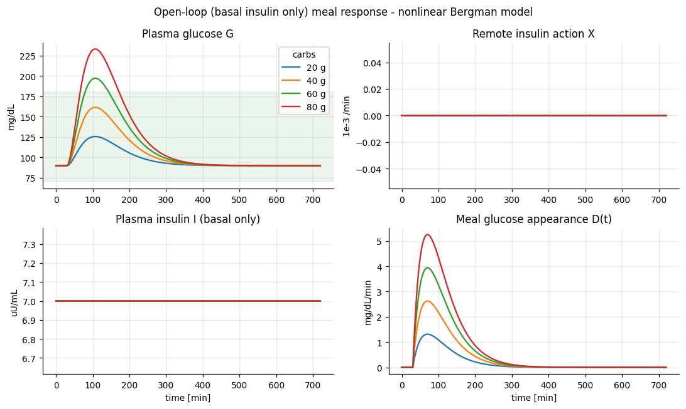

Open-loop peaks with basal insulin only: 20 g -> 126 mg/dL, 40 g -> 162 mg/dL, 60 g -> 197 mg/dL, 80 g -> 233 mg/dL.

## 3. Linearization and transfer function (Phase 3)
About (Gb, 0, Ib), with deviation states g, x, i the only nonlinearity X G becomes Gb x:

```
A = [[-p1, -Gb, 0], [0, -p2, p3], [0, 0, -n]]   B = [0, 0, 1/VI]^T   E = [1, 0, 0]^T   C = [1 0 0]
G(s) = g/u = - Gb p3 / (VI (s+p1)(s+p2)(s+n))
```
DC gain -1.498 mg/dL per mU/min; three real stable poles at -p1, -p2, -n; no zeros; relative degree 3 (insulin lowers glucose, so the gain is negative and controllers use positive gain on e = G - r).
Linear-vs-nonlinear max error with a 60 g meal plus an insulin step: 5.0 mU/min -> 6.1 mg/dL, 20.0 mU/min -> 17.3 mg/dL, 60.0 mU/min -> 44.9 mg/dL. The linear model is only a local design model; all performance numbers in section 6 use the nonlinear plant.

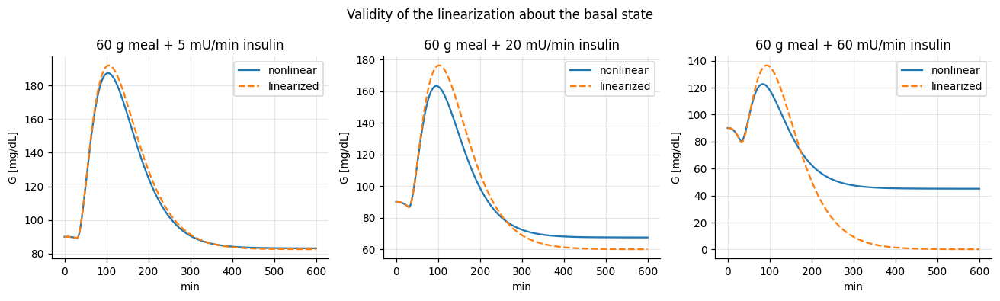

## 4. Time response and stability (Phase 4)
- Open loop: Routh-Hurwitz first column has no sign changes -> asymptotically stable, overdamped, 2% settling 233 min.
- PID: closed-loop characteristic polynomial of order 5, Routh sign changes = 0 -> stable.
- Constrained PI (IOB): closed-loop characteristic polynomial of order 4, Routh sign changes = 0 -> stable.
- P-only ultimate gain from Routh: k_u = 7.76 mU/min per mg/dL (oscillation period 84 min).

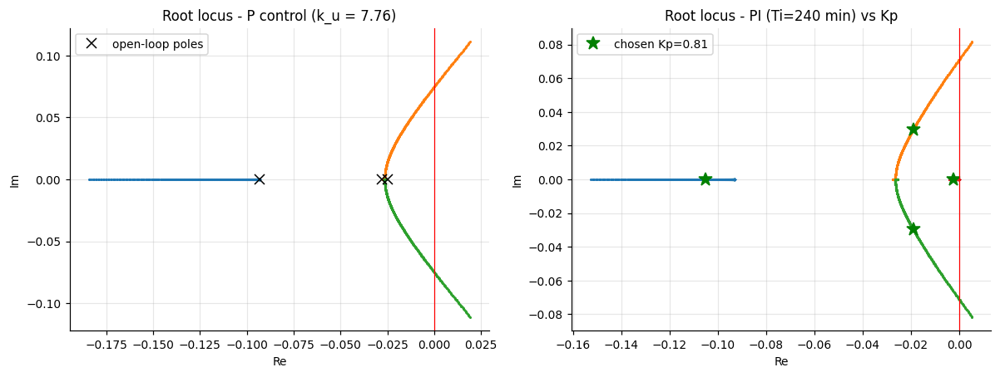

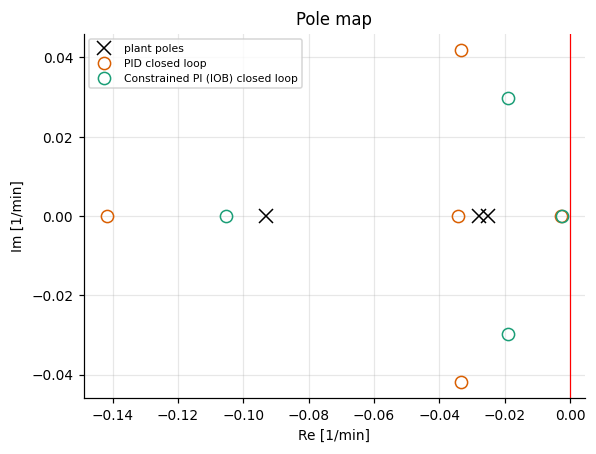

## 5. Frequency-domain analysis (Phase 5)
| controller | GM dB | PM deg | wgc rad/min | delay margin min | Ms | Mt | bw rad/min |
|---|---|---|---|---|---|---|---|
| PID | 19.4 | 103 | 0.019 | 95 | 1.28 | 1.00 | 0.006 |
| Constrained PI (IOB) | 18.6 | 100 | 0.013 | 130 | 1.32 | 1.00 | 0.005 |
| LQR + observer | 10.3 | 40 | 0.062 | 11 | 1.91 | 1.47 | 0.116 |

Delay margin = PM/wgc is the CGM-plus-pump delay the loop can tolerate. Ms is the peak of the sensitivity function.

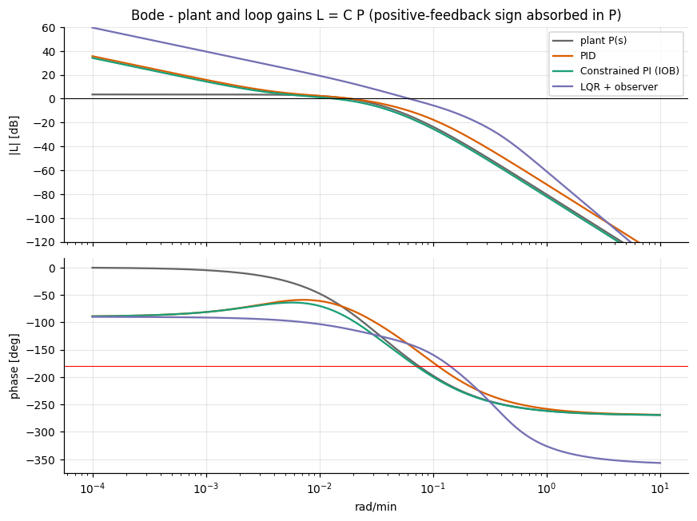

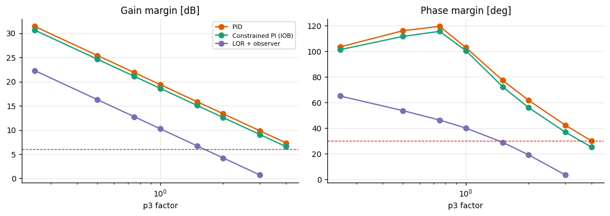

Robustness to patient gain (insulin sensitivity p3) is plotted above: the margins shrink as the patient becomes more insulin sensitive, and the observer-based LQR loop has the least margin (the observer adds phase lag).

## 6. Controller design and comparison (Phase 6)
- **PID** (baseline): {'Kp': 0.9655, 'Ki': 0.004023, 'Kd': 16.86, 'Tf': 10.0}; filtered derivative, back-calculation anti-windup, 0 <= u <= 200 mU/min.
- **Constrained PI**: {'Kp': 0.8133, 'Ki': 0.003389, 'B_max': 900.0}; insulin-on-board (IOB) projection keeps IOB <= B_max exactly (ZOH projection), low-glucose suspend below 80 mg/dL (also on predicted 20 min).
- **LQR + observer**: integral LQR on [g, x, i, z], Kalman-Bucy observer on [g, x, i, d] (meal as constant disturbance), weights qz=0.43148, rho=0.99988.
- **Pole placement + observer**: closed-loop poles [-0.06, -0.07, -0.1, -0.12] (comparison to LQR).

Gains were tuned numerically on the nonlinear model (3 patient sensitivities, 10 min CGM delay, 3 mg/dL noise, margin penalties).

**Nominal patient, 60 g meal:**

| controller | peak mg/dL | t_peak min | min mg/dL | TIR % | hypo min | settle min | IAE g.h/dL | insulin U |
|---|---|---|---|---|---|---|---|---|
| open loop | 197 | 77 | 90 | 91 | 0 | 224 | 272 | 5.6 |
| PID | 163 | 46 | 89 | 100 | 0 | 329 | 135 | 9.5 |
| Constrained PI (IOB) | 176 | 53 | 86 | 100 | 0 | 348 | 167 | 9.6 |
| LQR + observer | 133 | 32 | 89 | 100 | 0 | 145 | 45 | 10.0 |
| Pole placement + observer | 135 | 35 | 85 | 100 | 0 | 207 | 63 | 10.0 |

**With CGM noise 3 mg/dL and 10 min delay:**

| controller | peak mg/dL | t_peak min | min mg/dL | TIR % | hypo min | settle min | IAE g.h/dL | insulin U |
|---|---|---|---|---|---|---|---|---|
| open loop | 197 | 77 | 90 | 91 | 0 | 224 | 272 | 5.6 |
| PID | 176 | 51 | 85 | 100 | 0 | 444 | 169 | 10.9 |
| Constrained PI (IOB) | 188 | 57 | 83 | 97 | 0 | 238 | 158 | 8.6 |
| LQR + observer | 154 | 40 | 83 | 100 | 0 | 392 | 134 | 12.7 |
| Pole placement + observer | 153 | 42 | 78 | 100 | 0 | 463 | 169 | 14.0 |

**Stress test, 100 g meal:**

| controller | peak mg/dL | t_peak min | min mg/dL | TIR % | hypo min | settle min | IAE g.h/dL | insulin U |
|---|---|---|---|---|---|---|---|---|
| PID | 201 | 43 | 84 | 96 | 0 | 474 | 200 | 14.0 |
| Constrained PI (IOB) | 222 | 50 | 88 | 93 | 0 | 355 | 213 | 12.0 |
| LQR + observer | 162 | 34 | 84 | 100 | 0 | 184 | 78 | 14.5 |
| Pole placement + observer | 161 | 34 | 79 | 100 | 0 | 244 | 101 | 14.9 |

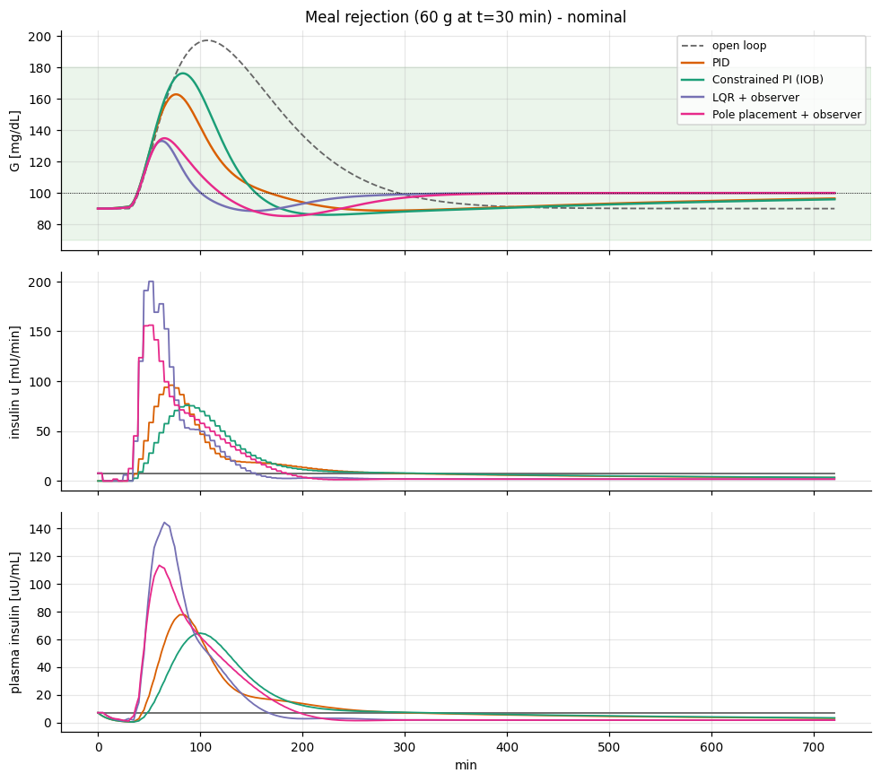

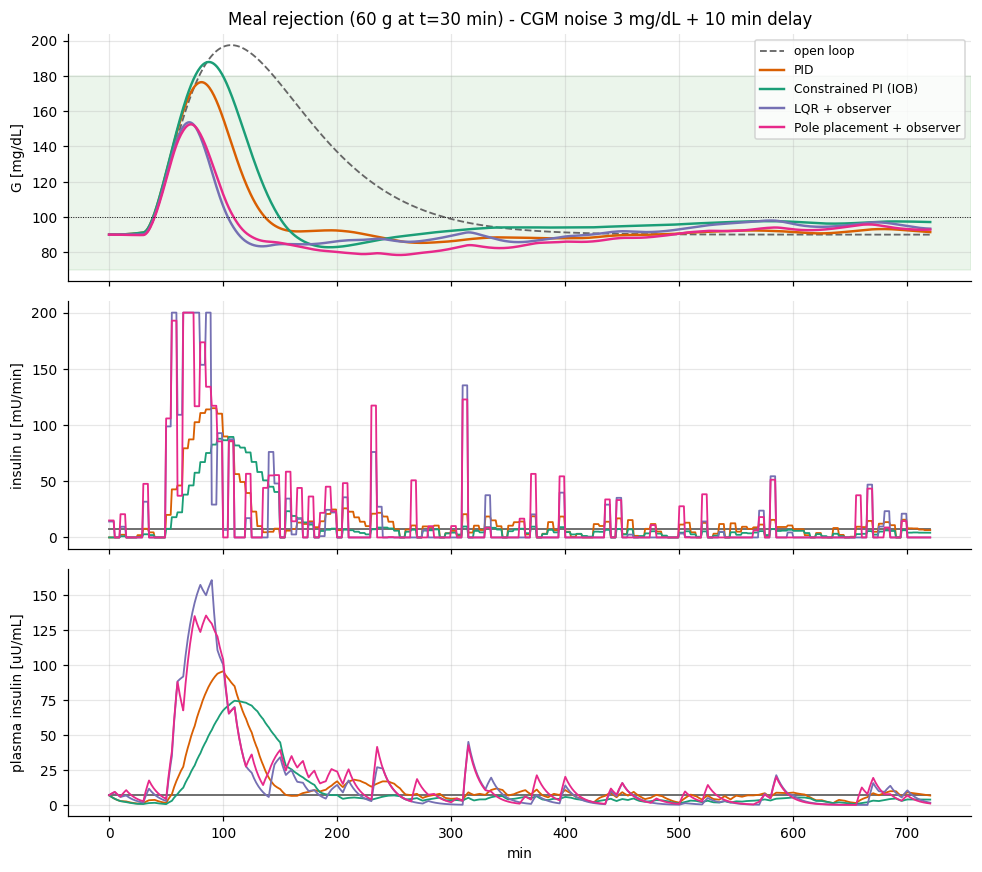

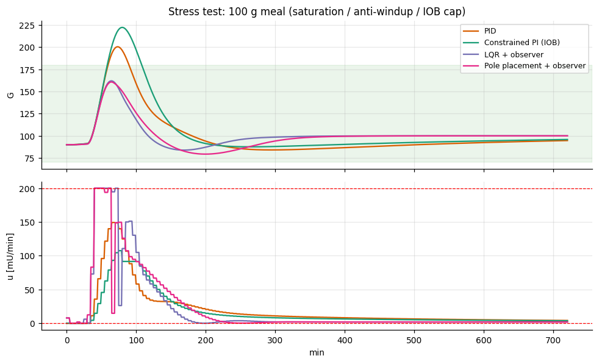

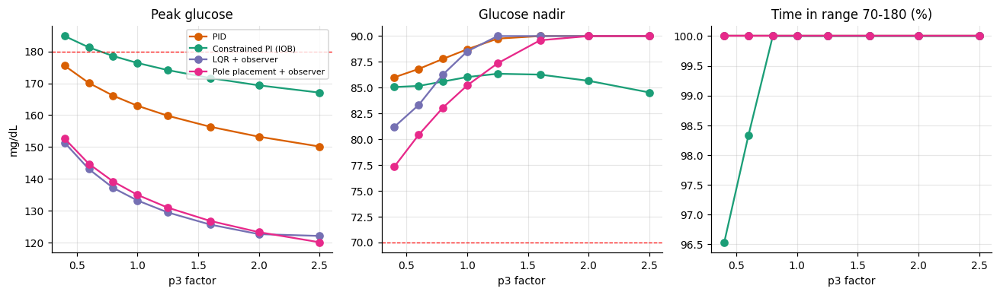

Lowest peak glucose: **LQR + observer** (133 mg/dL vs 197 open loop). Trade-offs: the PI/PID loops are gentle and robust but slow to settle (the integral action is deliberately slow to avoid hypoglycaemia); the LQR loop is faster and lowers the peak more but saturates the pump and has smaller stability margins; none of the controllers can remove the delay of the insulin pathway, so an unannounced meal always produces a peak.

## 7. State-space analysis (Phase 7)
- Controllability matrix rank 3/3 -> controllable (condition number 1.7e+04: controllable but ill-conditioned).
- Observability from CGM glucose: rank 3/3; augmented model with meal disturbance rank 4/4.
- LQR gains Kx = [-13.493, 17311.8376, 1.4621], Kz = -0.6569; separation principle gives stable combined poles.

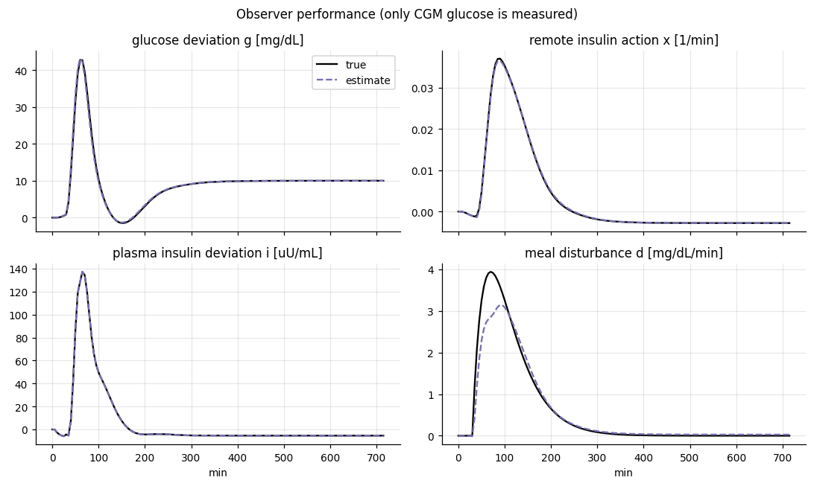

## 8. Conclusions and limitations
- A model-based controller with an observer rejects the meal best, at the price of robustness margin and pump saturation; PID/PI with anti-windup and IOB limiting gives a safe, robust baseline with no hypoglycaemia in the tested scenarios.
- The minimal model is a single-compartment, population-average model; real patients also have CGM lag, subcutaneous insulin delay (not in the model), exercise, stress and sensor errors. Parameters are literature-typical values, not patient data. This is a coursework simulation, not a clinical device.
- Glucose starts at the 90 mg/dL basal level (below the 100 mg/dL target), so 'minimum glucose' in the tables is ~85-90 and reflects that start, not a hypoglycaemia dip.
